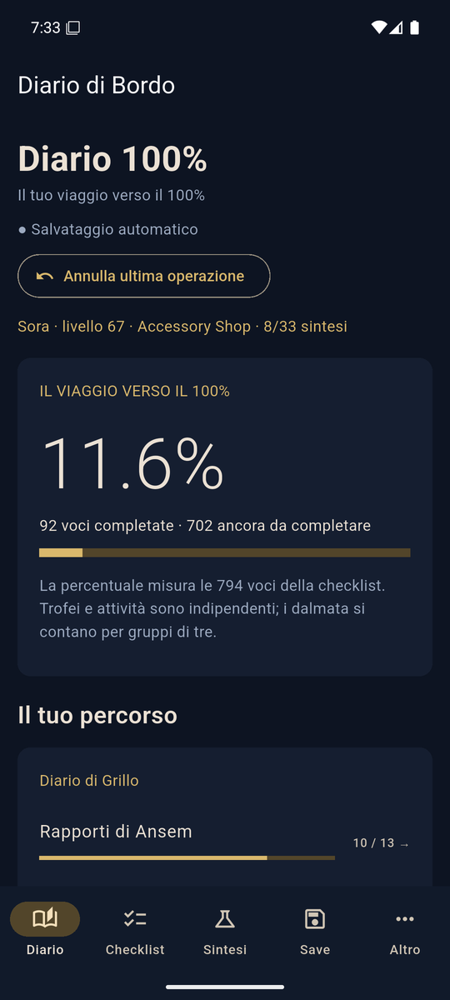
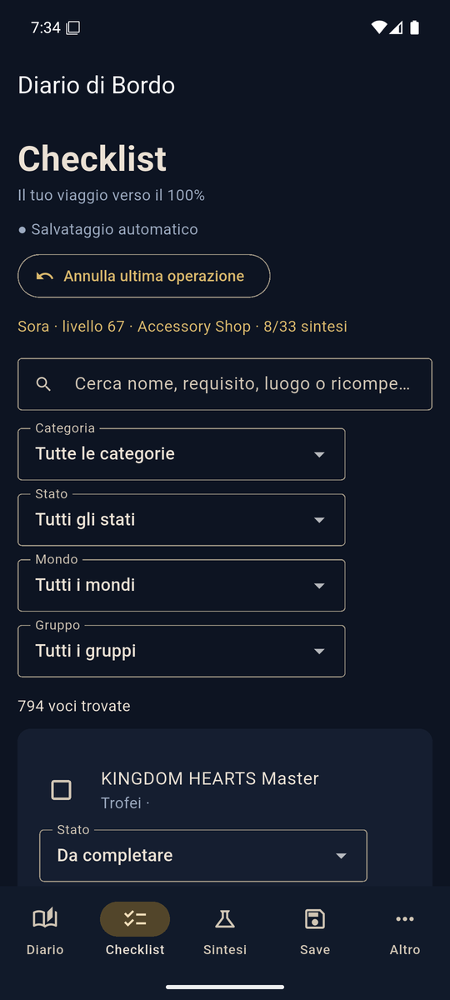
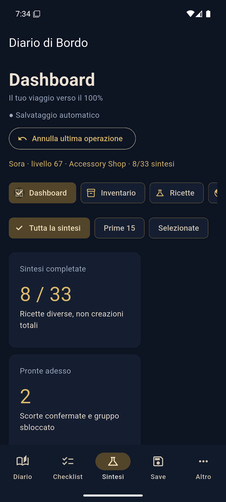
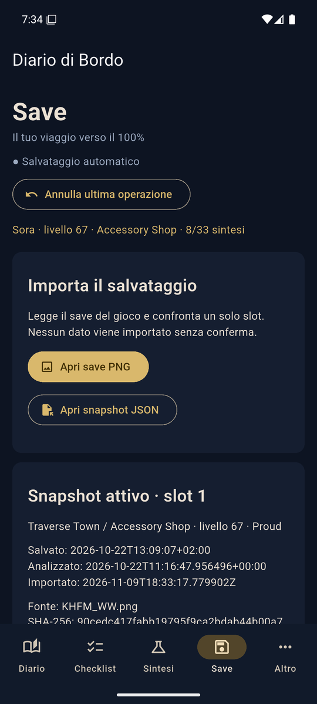
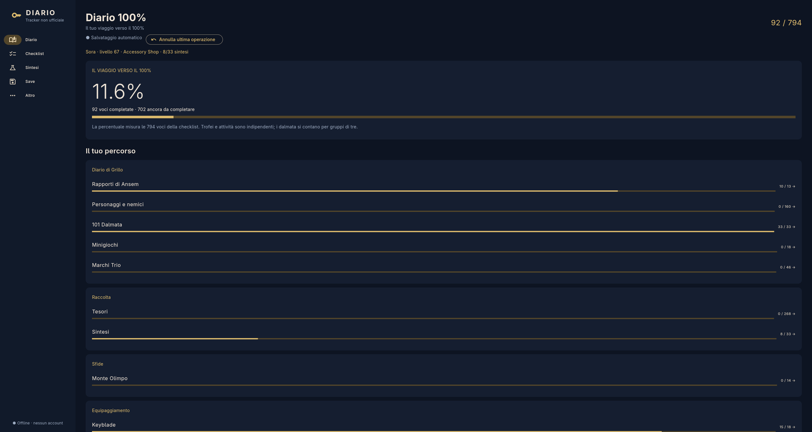

# Diario di Bordo

App per tenere traccia del completamento di **Kingdom Hearts 1** (Final Mix): checklist delle 794 voci, sintesi, inventario dei materiali, farming e lettura del salvataggio. Funziona offline, senza account. Pensata soprattutto per il telefono, gira anche su Linux.

> **App non ufficiale.** Non è affiliata, approvata o sponsorizzata da Square Enix o Disney. *Kingdom Hearts* e tutti i nomi, i personaggi e i marchi collegati appartengono ai rispettivi proprietari, che ne detengono tutti i diritti. L'app non contiene loghi, artwork, musiche o file del gioco: è uno strumento gratuito, fatto da un fan per seguire i propri progressi.

<p>
  
  
  
  
</p>



## Cosa fa

- **Diario:** percentuale di completamento e avanzamento per categoria (rapporti di Ansem, dalmata, tesori, trofei…).
- **Checklist:** 794 voci, con ricerca e filtri per categoria, stato, mondo e gruppo. Una voce può essere completata, da completare o da verificare.
- **Sintesi:** inventario dei materiali, 33 ricette con i gruppi di sblocco, piano di sintesi con i materiali mancanti, fonti di farming e collezionabili.
- **Save:** legge il file di salvataggio della versione PC (`KHFM_WW.png`) e mostra le differenze slot per slot. Non importa nulla senza conferma.
- **Backup:** export e import del profilo in JSON. Le ultime 100 operazioni si possono annullare.

## Come è fatta

Flutter/Dart, con un codice unico per Android, iOS e desktop.

- **Architettura a livelli.** Il dominio è Dart puro (motore delle regole, validazione, decoder del save) ed è separato dai dati (repository) e dall'interfaccia (feature).
- **Riverpod** per lo stato e **go_router** per la navigazione: barra in basso su telefono, NavigationRail sugli schermi larghi.
- **SQLite con drift.** Lo schema è versionato, le migrazioni sono testate (v1 → v2) e c'è un controllo delle chiavi esterne dopo ogni upgrade. Il modello dati è predisposto per più titoli (`game_id`).
- **Test** su tre livelli: unità del dominio, repository su drift in memoria con test di migrazione, widget con override dei provider. I test di parità confrontano il motore con i risultati della versione precedente dell'app. Il decoder è verificato su un salvataggio reale incluso come fixture in `test/fixtures/`.

```
lib/
  domain/        regole, validazione, decoder del save (Dart puro)
  data/          repository drift, schema e migrazioni
  application/   provider Riverpod
  features/      diario, checklist, sintesi, save, altro
  app/           router e shell di navigazione
```

## Avvio

Serve Flutter stable (Dart ≥ 3.9).

```bash
flutter pub get
flutter test
flutter run            # dispositivo o emulatore collegato
flutter run -d linux
```

Al primo avvio il profilo è vuoto. I progressi si segnano a mano, oppure si legge il proprio salvataggio dalla schermata Save.
